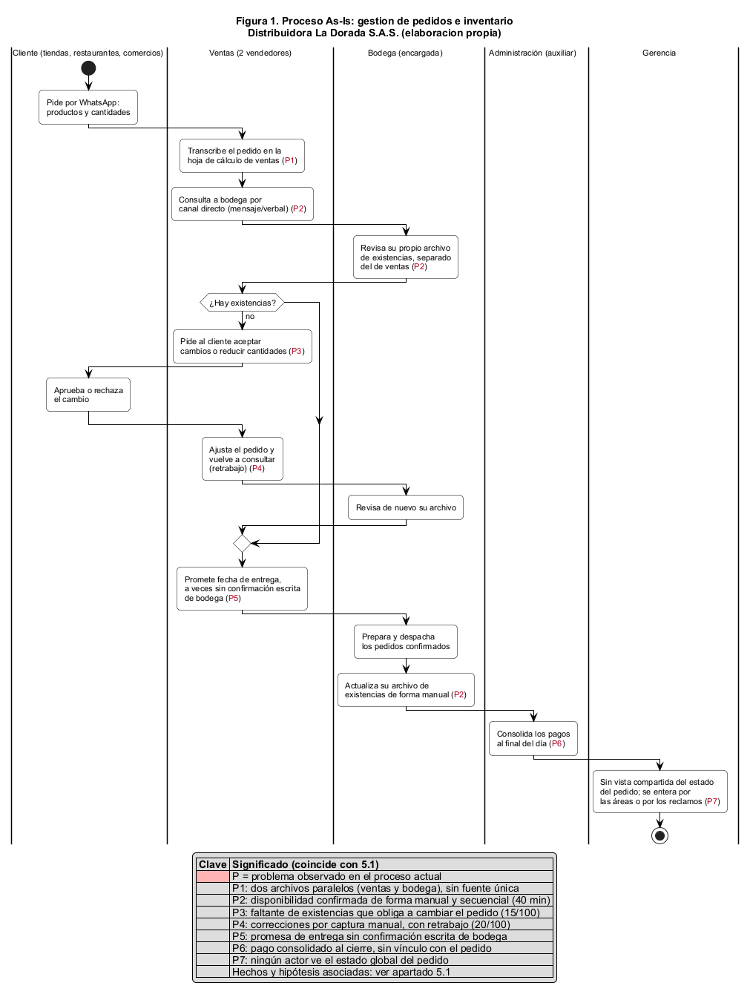
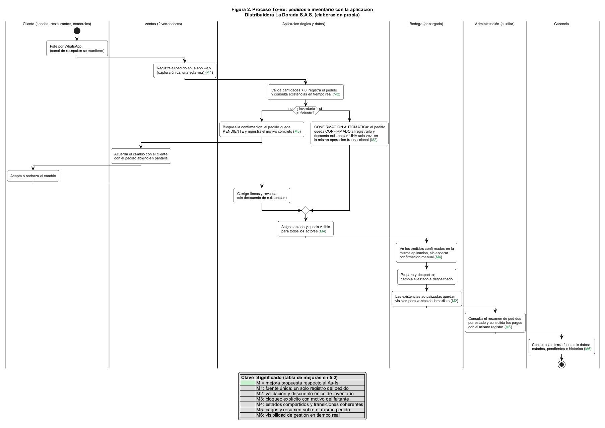
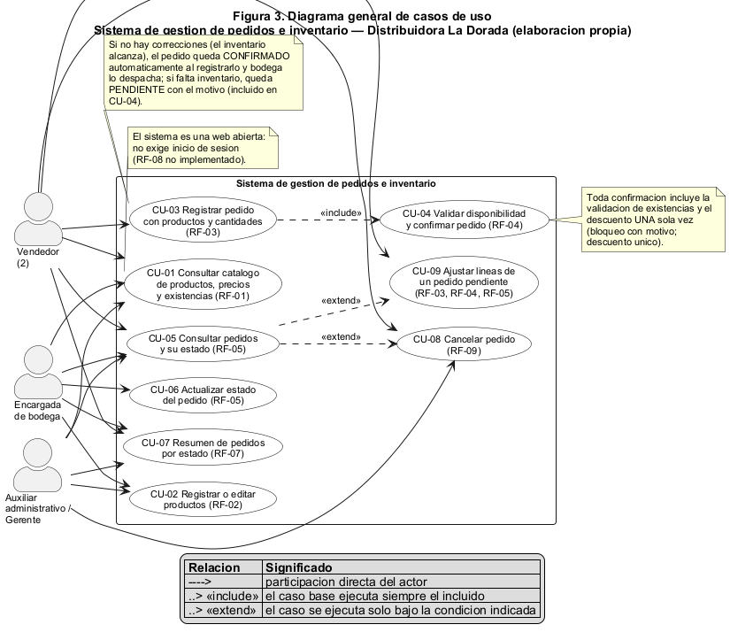
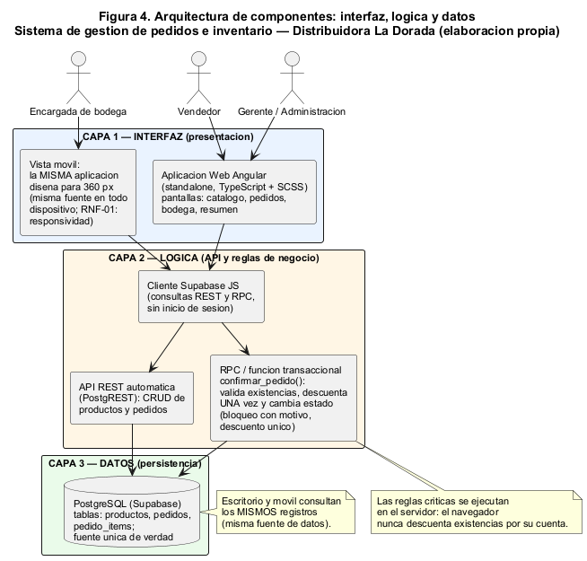
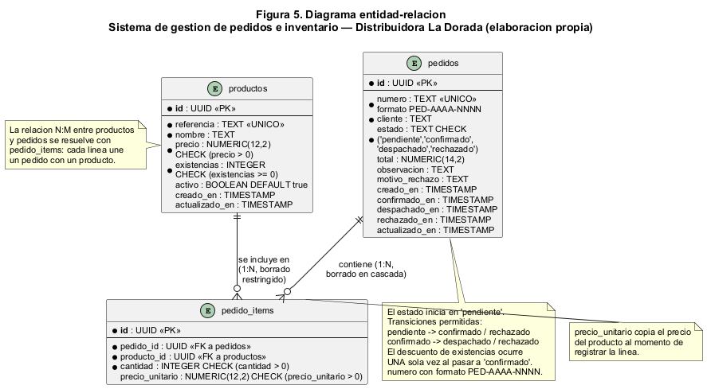

# DOCUMENTO TÉCNICO — Sistema de gestión de pedidos e inventario
## Distribuidora La Dorada S.A.S.

| Campo | Detalle |
|---|---|
| Asignatura | Desarrollo de Sistemas de Información Empresariales |
| Proyecto | Proyecto final integrador — sistema de pedidos e inventario |
| Equipo | **Equipo 5** — Felipe González · Juan Esteban Alzate · Santiago Castrillón |
| Grupo | [Grupo] |
| Fecha | [dd/mm/aaaa] |
| Versión del documento | v3.3 — web abierta sin inicio de sesión (RF-08 no implementado), modelo de datos simplificado a las tres entidades del negocio |

> **Regla de la guía:** cada diagrama, tabla o prueba aparece **una sola vez** y en su apartado. Este documento no repite contenido entre secciones.

### Estado de los apartados

| Apartado | Título | Estado |
|---|---|---|
| 5.1 | Diagnóstico y actores | ✅ Borrador completo |
| 5.2 | Procesos As-Is y To-Be | ✅ Borrador completo (diagramas + tabla de mejoras) |
| 5.3 | Requerimientos y alcance | ✅ Borrador completo |
| 5.4 | Historias y casos de uso | ✅ Borrador completo (3 historias + **8 casos de uso detallados**) |
| 5.5 | Arquitectura e integración | ✅ Borrador completo |
| 5.6 | Modelo de datos | ✅ Completo (tablas desplegadas en Supabase — ver 5.6.4) |
| 5.7 | Seguridad y roles | ✅ Matriz propuesta documental (RF-08 no implementado: la web es abierta) |
| 5.8 | Pruebas funcionales | ✅ T-01, T-02 y T-03 ejecutadas con resultado real y con evidencia en `docs/evidencias/` |
| 5.9 | Métricas de éxito | ✅ Borrador completo (metas hipotéticas) |
| 5.10 | Balance final | ✅ Actualizado con lo construido y lo pendiente |

---

# JORNADA 1 · ANÁLISIS

## 5.1 Diagnóstico y actores

### 5.1.1 Descripción del negocio

Distribuidora La Dorada S.A.S. es una empresa ficticia que vende **artículos de aseo y limpieza** a tiendas, restaurantes y pequeños comercios. Su planta organizacional es pequeña: **una gerente, dos vendedores, una encargada de bodega y un auxiliar administrativo**.

El proceso actual funciona así: los clientes piden por **WhatsApp**; el área de ventas **transcribe los pedidos a una hoja de cálculo** y consulta a bodega, que controla las existencias en **otro archivo distinto**. Cuando faltan unidades, ventas pide al cliente que acepte los cambios. Bodega prepara y despacha los pedidos confirmados y administración **consolida los pagos al final del día**. No existe una vista compartida del estado de los pedidos, y algunas entregas se prometen **sin confirmación escrita de bodega**.

La gerencia encarga al equipo analizar el proceso y construir una **primera versión funcional** que conecte productos, inventario y pedidos.

### 5.1.2 Hechos y datos vs. hipótesis

La guía exige **distinguir los hechos de las hipótesis**. Los hechos son datos que el caso entrega; las hipótesis son causas posibles que el equipo propone y que deben verificarse con el sistema o con medición, no se presentan como causas probadas.

**Hechos del caso (datos entregados):**

| Código | Hecho | Dato |
|---|---|---|
| H-1 | Los pedidos llegan por WhatsApp y se transcriben a una hoja de cálculo | — |
| H-2 | Ventas y bodega manejan archivos de información separados | 2 archivos paralelos |
| H-3 | Pedidos recibidos en una semana ficticia | 100 pedidos |
| H-4 | Pedidos que requirieron correcciones | 20 (20 %) |
| H-5 | Pedidos retrasados por falta de existencias | 15 (15 %) |
| H-6 | Tiempo promedio para confirmar disponibilidad | 40 minutos |
| H-7 | No hay vista compartida del estado de los pedidos | — |
| H-8 | Algunas entregas se prometen sin confirmación escrita de bodega | — |
| H-9 | Los pagos se consolidan al final del día | 1 consolidado diario |

> La guía advierte que estos datos **son didácticos: no demuestran por sí solos las causas** de cada dificultad. Por eso las causas se enuncian como hipótesis.

**Hipótesis de causa (por verificar):**

| Código | Hipótesis de causa | Hecho que la motiva | Cómo verificarla |
|---|---|---|---|
| X-1 | La información fragmentada entre dos archivos obliga a re-digitar y genera datos inconsistentes | H-1 (los pedidos llegan por WhatsApp y se transcriben a una hoja de cálculo) y H-2 (ventas y bodega manejan archivos separados) | Comparar el mismo pedido en ambos archivos tras la implementación |
| X-2 | La confirmación de disponibilidad es secuencial y depende de una persona, lo que explica los 40 minutos | H-6 (40 minutos en promedio para confirmar disponibilidad) | Medir el tiempo de confirmación con la aplicación (ver 5.9) |
| X-3 | Al no validar existencias antes de prometer, se aceptan pedidos que no se pueden cumplir | H-5 (15 pedidos retrasados por falta de existencias) y H-8 (entregas prometidas sin confirmación escrita de bodega) | Contar los pedidos bloqueados por inventario con el motivo registrado |
| X-4 | La ausencia de estados compartidos impide saber en qué va cada pedido | H-7 (no hay vista compartida del estado de los pedidos) | Consultar el estado del pedido desde las tres áreas en la misma pantalla |
| X-5 | Las correcciones se originan en la captura manual sin validación en el momento | H-4 (20 de 100 pedidos requirieron correcciones) | Registrar el motivo de cada corrección en la app |

### 5.1.3 Problemas identificados y posibles causas

| Código | Problema (fenómeno observable) | Hecho que lo demuestra | Posible causa (hipótesis) | Consecuencia |
|---|---|---|---|---|
| P1 | Ventas y bodega trabajan sobre archivos distintos con la misma información | H-1 (pedidos por WhatsApp transcritos a una hoja de cálculo) y H-2 (dos archivos de información separados) | X-1: no existe una fuente única de datos | Doble digitación, datos desactualizados, sin trazabilidad |
| P2 | Confirmar la disponibilidad toma 40 minutos en promedio | H-6 (40 minutos en promedio) | X-2: la consulta es manual, secuencial y depende de una persona | Pedidos demorados y promesas de entrega poco confiables |
| P3 | 15 de 100 pedidos se retrasaron por falta de existencias y obligaron a cambiar el pedido | H-5 (15 de 100 pedidos retrasados) | X-3: no hay validación de inventario antes de comprometer la entrega | Retrasos, cambios de último momento, molestia del cliente |
| P4 | 20 de 100 pedidos requirieron correcciones y generaron retrabajo | H-4 (20 de 100 pedidos con correcciones) | X-5: la captura es manual y sin validación en el origen | Reproceso en ventas y bodega, pérdida de tiempo |
| P5 | Algunas entregas se prometen sin confirmación escrita de bodega | H-8 (promesas de entrega sin confirmación escrita) | X-3 y X-4: no hay registro formal de la preparación del pedido | Compromisos incumplidos y reprogramaciones |
| P6 | Los pagos se consolidan al cierre sin vínculo formal con el estado de cada pedido | H-9 (los pagos se consolidan al final del día) | X-1: la consolidación no se apoya en un registro único de pedidos | Dificultad para conciliar qué se pagó, qué se despachó y qué está pendiente |
| P7 | No hay una vista compartida del estado del pedido | H-7 (no hay vista compartida del estado) | X-4: el proceso no modela estados ni transiciones | Cada área responde versiones distintas al cliente |

### 5.1.4 Áreas y actores

| Actor | Rol en el proceso | Área | Interés principal |
|---|---|---|---|
| Cliente (tiendas, restaurantes, comercios) | Solicita productos y cantidades; aprueba cambios cuando falta inventario | Externo | Recibir lo pedido, completo y a tiempo |
| Vendedor (×2) | Transcribe el pedido, consulta disponibilidad, acuerda cambios, promete entrega | Ventas | Registrar pedidos rápido y con información confiable |
| Encargada de bodega | Controla existencias, prepara y despacha los pedidos confirmados | Bodega | Saber qué preparar y no vender unidades inexistentes |
| Auxiliar administrativo | Consolida los pagos al final del día | Administración | Conciliar pagos con pedidos entregados |
| Gerente | Supervisa y recibe los reclamos | Gerencia | Visibilidad del estado y del desempeño |

> Los roles de esta tabla son **roles del proceso** (actores del caso), no usuarios del sistema: en esta versión la web es **abierta y no distingue usuarios** (RF-08 no implementado); la matriz de permisos por rol del apartado 5.7 es una propuesta documental.

### 5.1.5 Flujo de información actual

| # | Emisor | Información | Receptor | Medio actual | Problema asociado |
|---|---|---|---|---|---|
| 1 | Cliente | Solicitud (productos, cantidades) | Ventas | WhatsApp | Sin registro estructurado |
| 2 | Ventas | Pedido transcrito | Ventas (su archivo) | Hoja de cálculo | P1 (archivos paralelos sin fuente única) |
| 3 | Ventas | Pregunta de disponibilidad | Bodega | Mensaje o verbal | P2 (consulta manual, 40 min en promedio) |
| 4 | Bodega | Respuesta de existencias (de su archivo) | Ventas | Mensaje o verbal | P1 (archivos paralelos) y P2 (consulta manual) |
| 5 | Ventas | Propuesta de cambio por faltantes | Cliente | WhatsApp | P3 (faltante de existencias que obliga a cambiar el pedido) |
| 6 | Ventas | Promesa de fecha de entrega | Cliente | WhatsApp | P5 (promesa sin confirmación escrita de bodega) |
| 7 | Bodega | Pedido preparado/despachado | Ventas y Administración | Informal / sin registro | P5 (sin confirmación escrita) y P7 (sin vista compartida del estado) |
| 8 | Administración | Consolidado de pagos del día | Gerencia | Hoja de cálculo | P1 (dos archivos paralelos) y P6 (pagos sin vínculo con el pedido) |

---

## 5.2 Procesos As-Is y To-Be

### 5.2.1 Proceso actual (As-Is)

*Figura 1. Proceso As-Is (elaboración propia con PlantUML). El color rojo marca los puntos críticos; los códigos P1–P7 corresponden a la tabla de problemas del apartado 5.1.*

### 5.2.2 Proceso propuesto (To-Be)

*Figura 2. Proceso To-Be (elaboración propia con PlantUML). El color verde marca las mejoras; los códigos M1–M6 corresponden a la tabla de mejoras de este apartado. El canal de recepción por WhatsApp se mantiene: el cambio está en que el pedido pasa a registrarse una sola vez en el sistema, y **la confirmación es automática al registrarlo**: si no hay correcciones (el inventario alcanza), el pedido queda **confirmado** y bodega lo despacha sin esperar una confirmación manual; si hay faltante, queda `pendiente` con el motivo. La consolidación de pagos al cierre del día se conserva como actividad de reporte sobre los mismos pedidos (mejora M5), no como paso previo al despacho.*

### 5.2.3 Mejoras esperadas

| Código | Mejora esperada | En el As-Is | En el To-Be | Cómo verificarla |
|---|---|---|---|---|
| M1 | **Fuente única de información**: un solo registro del pedido | Dos archivos paralelos (ventas y bodega) con datos del mismo pedido | Productos, existencias y pedidos viven en la misma base de datos | El mismo pedido consultado por ventas, bodega y administración muestra idénticos datos |
| M2 | **Validación de inventario en línea y descuento único** | Confirmación manual, secuencial y sujeta a error; posible doble descuento | La existencia se verifica **al registrar el pedido**: si alcanza, el pedido queda confirmado automáticamente y se descuenta exactamente una vez, en la misma operación (la confirmación ocurre sola al registrarse el pedido) | Escenarios T-01 (pedido válido) y T-02 (pedido inválido) del apartado 5.8 |
| M3 | **Rechazo explícito con motivo** | El cliente entera del faltante tarde y por mensaje | Si no alcanza el inventario, el pedido queda `pendiente` y se muestra el motivo concreto con las existencias disponibles | Intentar pedir más de lo disponible devuelve un mensaje y no modifica existencias |
| M4 | **Estados compartidos y transiciones coherentes** | Cada área informa a su manera; sin vista común | Pedidos con estados definidos y visibles para todos los actores | Consultar el estado del mismo pedido desde escritorio y desde teléfono |
| M5 | **Pagos ligados al pedido** | Consolidado de pagos al cierre, sin vínculo formal | El resumen de pedidos por estado alimenta la consolidación de pagos | El total de un pedido coincide con el consolidado del día |
| M6 | **Visibilidad en tiempo real para la gerencia** | La gerencia se entera por las áreas o por reclamos | La misma fuente de datos responde estados, pendientes e histórico | Tablero con pedidos por estado actualizado al recargar |

---

## 5.3 Requerimientos y alcance

### 5.3.1 Requerimientos funcionales

| Código | Requerimiento | Prioridad MoSCoW | Criterio de aceptación |
|---|---|---|---|
| RF-01 | Consultar productos, precios y existencias | **Must** | Desde el listado se ven referencia/nombre, precio y existencias de cada producto; la consulta funciona tras cerrar y reabrir la aplicación |
| RF-02 | Registrar o editar productos | **Must** | Se puede crear un producto y modificar su precio o existencias; el cambio persiste y se refleja en el listado sin recargar la base |
| RF-03 | Registrar pedidos con productos y cantidades | **Must** | Un pedido admite varias líneas (producto + cantidad > 0), se guarda con su detalle consultable y, si el inventario alcanza, queda **confirmado automáticamente** en el mismo flujo |
| RF-04 | Validar existencias y bloquear la confirmación inválida | **Must** | Si la cantidad supera las existencias, la confirmación se impide **y se muestra el motivo**; las existencias no cambian |
| RF-05 | Consultar pedidos y actualizar estados | **Must** | El pedido muestra su estado y solo admite las transiciones definidas (pendiente → confirmado → despachado; rechazado desde pendiente o confirmado) |
| RF-06 | Guardar y recuperar registros | **Must** | Cerrando y reabriendo la aplicación, los productos y pedidos registrados siguen disponibles con sus datos |
| RF-07 | Resumen de pedidos por estado | **Should** | Pantalla con el conteo de pedidos en cada estado y el valor total asociado, actualizada con los cambios de estado |
| RF-08 | Autenticación y permisos diferenciados | **Could** | **No implementado en esta versión:** la matriz de la propuesta documental de 5.7.1 queda como diseño para una versión futura con sesión; la web actual es abierta (cualquiera con la dirección consulta y opera todas las acciones) |
| RF-09 | Cancelación de un pedido por parte de ventas | **Should** | Un pedido pendiente o confirmado puede cancelarse con motivo; pasa a estado `rechazado` y, si estaba `confirmado`, las existencias descontadas se reponen **una sola vez** en la misma operación (reversión explícita) |
| RF-10 | Búsqueda y filtro de productos por nombre o referencia | **Could** | El catálogo permite localizar un producto escribiendo parte de su nombre o referencia |

**Priorización (MoSCoW):** 6 *Must*, 2 *Should*, 2 *Could*. El desarrollo de la Jornada 3 se concentra en los seis *Must*; *Should* entra solo si están cubiertos, y *Could* no compromete la entrega.

### 5.3.2 Requerimientos no funcionales verificables

| Código | Requerimiento no funcional | Criterio de verificación (verificable) |
|---|---|---|
| RNF-01 | **Responsividad**: la interfaz debe servir en computador y en teléfono | En las tres pantallas clave (catálogo, registro de pedido, detalle de pedido) no hay scroll horizontal a 360 px de ancho y siguen siendo utilizables a 1280 px |
| RNF-02 | **Tiempo de respuesta**: la consulta debe ser percibida como inmediata | Listado de productos y de pedidos carga en menos de 2 segundos con 500 registros de prueba |
| RNF-03 | **Persistencia de la información** | Tras cerrar y reabrir la aplicación, los registros creados siguen presentes con sus mismos valores (escenario T-03: consulta móvil y persistencia) |
| RNF-04 | **Integridad del inventario**: no se admiten descuentos duplicados | Después de confirmar un pedido (T-01: pedido válido) o de reintentarlo, las existencias se han descontado **una sola vez**; en T-02 (pedido inválido) no cambian |
| RNF-05 | **Consistencia entre dispositivos**: escritorio y móvil usan los mismos datos | Un pedido registrado en escritorio se consulta desde un teléfono con el mismo estado y detalle |
| RNF-06 | **Usabilidad básica** | Acciones principales completables en máximo 3 interacciones desde la pantalla inicial y con botones de área táctil ≥ 44 px en la vista móvil |

### 5.3.3 Alcance incluido

- Aplicación **web responsiva** (computador y teléfono desde el navegador).
- Catálogo de productos con consulta, registro y edición.
- Registro de pedidos con una o varias líneas y validación de disponibilidad antes de confirmar.
- Consulta del detalle y del estado de los pedidos, con transiciones coherentes.
- Persistencia de la información entre sesiones.
- Datos ficticios precargados: catálogo de 15 productos de prueba (el sembrado no incluye pedidos de muestra; se crean al probar el sistema).

### 5.3.4 Exclusiones

- Integración con **WhatsApp** (el canal se usa para recibir pedidos, pero no se conecta a la API).
- **Pagos reales**, facturación fiscal, contabilidad y logística avanzada.
- Aplicación **móvil nativa** (opcional en la guía y sin puntos adicionales por sí sola).
- **Autenticación y permisos diferenciados** en esta versión: la matriz de roles del apartado 5.7 es **propuesta documental**, no una funcionalidad implementada (RF-08: autenticación y permisos, prioridad Could).
- **Auditoría (bitácora de cambios):** no se implementa en esta versión; la tabla `auditoria` y sus disparadores se retiraron con la migración `0008` por decisión del equipo y quedan como mejora futura (5.10.2).
- Multicompañía, catálogo multimoneda, venta al detal con precios por cantidad, notificaciones automáticas y modo sin conexión.

### 5.3.5 Supuestos y dependencias

| Tipo | Descripción |
|---|---|
| Supuesto | Los datos del caso (100 pedidos, 20 correcciones, 15 retrasos, 40 min) se usan como **línea base didáctica**, no como medición de la empresa real |
| Supuesto | El canal de recepción sigue siendo WhatsApp: el sistema recibe el pedido cuando el vendedor lo digita |
| Dependencia | Disponibilidad de la base de datos y de las credenciales del proyecto para la persistencia |
| Riesgo | Concentrar el trabajo en la interfaz y dejar las reglas de negocio sin implementar (la guía penaliza explícitamente este caso) |

### 5.3.6 Reglas de negocio

Reglas de la guía que el sistema debe cumplir. Se aplican en los casos de uso, la arquitectura y las pruebas; esta es su tabla definitoria:

| Regla | Dónde se cumple en el sistema |
|---|---|
| **Rechazo de valores ≤ 0:** cantidades y precios deben ser **mayores que cero** (≤ 0 rechazadas); las existencias admiten **≥ 0** (un producto puede estar agotado) | Formularios con `min` y mensaje en pantalla («La cantidad debe ser al menos 1», «El precio debe ser un número mayor a 0»); en la base de datos `CHECK (cantidad > 0)`, `CHECK (precio > 0)` y `CHECK (existencias ≥ 0)`; la RPC `crear_pedido()` además rechaza cantidades que no sean enteros ≥ 1 (`CANTIDAD_INVALIDA`) |
| **Bloqueo con motivo:** si no alcanza el inventario, la confirmación se impide y se muestra el motivo con números concretos | RPC `confirmar_pedido()` → error `INVENTARIO_INSUFICIENTE: … (disponibles X, solicitados Y)`; la web la invoca **automáticamente al registrar el pedido** (y también al pulsar «Confirmar») y muestra el motivo amigable |
| **Descuento único:** las existencias se descuentan exactamente una vez, en una sola transacción | `confirmar_pedido()` con bloqueo de fila (`FOR UPDATE`), invocada en el mismo flujo de registro; el reintento recibe `TRANSICION_INVALIDA`; `CHECK (existencias ≥ 0)` |
| **Estados coherentes:** `pendiente → confirmado → despachado`; `rechazado` es un estado final | `CHECK` de estados, disparador `fn_pedidos_transicion()` y transiciones válidas mostradas en la web |
| **Misma fuente:** escritorio y móvil consultan los mismos registros | Supabase como única persistencia de productos y pedidos; la web no guarda datos de negocio localmente |

---

# JORNADA 2 · DISEÑO

## 5.4 Historias y casos de uso

### 5.4.1 Historias de usuario

**HU-01 — Vendedor: registrar y confirmar un pedido**

- **Como** vendedor, **quiero** registrar un pedido con varios productos y cantidades y ver, antes de confirmar, si el inventario alcanza, **para** no prometerle al cliente algo que bodega no puede despachar.
- **Valor de negocio:** ataca P3 (15 pedidos retrasados por faltante de existencias) y P5 (entregas prometidas sin confirmación de bodega), y acorta los 40 minutos que hoy toma confirmar la disponibilidad de forma secuencial (P2).
- **Criterios de aceptación:**
  1. El sistema rechaza cantidades menores o iguales a cero **antes** de guardar la línea y lo informa en pantalla (cantidades ≤ 0 rechazadas).
  2. Al registrar el pedido, si la cantidad supera las existencias, la confirmación queda bloqueada, el pedido sigue `pendiente` y se muestra el motivo con el inventario disponible (bloqueo con motivo).
  3. Si el inventario alcanza, el pedido queda en estado `confirmado` **automáticamente al registrarlo** y las existencias se descuentan **exactamente una vez** (descuento único); bodega puede despacharlo sin espera.

**HU-02 — Encargada de bodega: despachar desde el teléfono**

- **Como** encargada de bodega, **quiero** ver los pedidos confirmados y marcarlos como despachados desde el teléfono, **para** no depender de mensajes ni de un archivo de existencias aparte.
- **Valor de negocio:** elimina P5 (promesas de entrega sin confirmación escrita) y P7 (sin vista compartida del estado): bodega trabaja sobre la misma fuente que ventas y deja registro escrito de la preparación.
- **Criterios de aceptación:**
  1. La lista muestra los pedidos en estado `confirmado` con su detalle de líneas y cantidades.
  2. Al marcar el despacho, el estado cambia **una sola vez** y se registra fecha y hora.
  3. El mismo estado se observa desde el computador sin necesidad de recargar la base (escritorio y móvil consultan los mismos registros).

**HU-03 — Gerente / auxiliar administrativo: resumen y pagos**

- **Como** gerente y auxiliar administrativo, **quiero** ver el resumen de pedidos por estado con su valor total, **para** consolidar los pagos del día y detectar atrasos sin preguntar a cada área.
- **Valor de negocio:** resuelve P6 (pagos consolidados sin vínculo con el pedido) y P7 (falta de vista compartida del estado).
- **Criterios de aceptación:**
  1. El resumen cuenta y suma los pedidos de cada estado (`pendiente`, `confirmado`, `despachado`, `rechazado`).
  2. El total del período coincide con la suma de los pedidos que lo componen.
  3. El resumen se actualiza cuando cambia el estado de un pedido (RF-07: resumen de pedidos por estado).

### 5.4.2 Diagrama general de casos de uso

*Figura 3. Diagrama general de casos de uso (elaboración propia con PlantUML). Es el **único** diagrama de casos de uso del documento, como exige la guía. Los casos se relacionan con los códigos RF del apartado 5.3.*

### 5.4.3 Casos de uso detallados

El diagrama general (Figura 3) contiene **ocho casos de uso y todos se detallan aquí con sus flujos**, según la indicación del docente (la guía pide como mínimo dos). El código de cada caso es el mismo en la figura y en este apartado (`CU-01` … `CU-08`, de *Caso de Uso*), y cada caso se describe en una única tabla que reúne sus elementos **y sus flujos**:

| Caso de uso | Nombre | Actor principal | Requerimiento asociado |
|---|---|---|---|
| CU-01 | Consultar catálogo de productos | Vendedor, Bodega, Gerente | RF-01, RF-10 |
| CU-02 | Registrar o editar productos | Gerente, Bodega (solo existencias) | RF-02 |
| CU-03 | Registrar pedido con productos y cantidades | Vendedor | RF-03 |
| CU-04 | Validar disponibilidad y confirmar pedido | Vendedor (con el sistema) | RF-04 |
| CU-05 | Consultar pedidos y su estado | Vendedor, Bodega, Gerente | RF-05 |
| CU-06 | Actualizar estado del pedido | Encargada de bodega | RF-05 |
| CU-07 | Resumen de pedidos por estado | Gerente / Auxiliar administrativo | RF-07 |
| CU-08 | Cancelar pedido | Vendedor, Gerente | RF-09 |

#### CU-01. Consultar el catálogo de productos

| Elemento | Descripción |
|---|---|
| **Código** | CU-01 (RF-01 — consultar productos, precios y existencias; RF-10 — búsqueda por nombre o referencia) |
| **Actor principal** | Vendedor |
| **Actores secundarios** | Encargada de bodega, Gerente / Auxiliar administrativo |
| **Disparador** | Cualquier actor necesita conocer precios o existencias antes de vender, preparar un pedido o revisar inventario |
| **Precondiciones** | El catálogo contiene al menos un producto activo |
| **Flujo principal** | 1. El actor abre la pantalla de catálogo. 2. El sistema lista los productos con referencia, nombre, precio y existencias. 3. El actor (opcional) escribe parte del nombre o la referencia para buscar (RF-10). 4. El sistema filtra la lista y muestra los coincidentes. 5. El actor revisa la información; al salir, el sistema no cambia nada. |
| **Flujos alternativos** | **A1 — Catálogo vacío:** si no hay productos, el sistema muestra «No hay productos registrados en el sistema.» y la pantalla ofrece el botón «Nuevo Producto» (CU-02). **A2 — Sin coincidencias en la búsqueda:** el sistema muestra «No hay coincidencias para la búsqueda.» y ofrece un botón para limpiar la búsqueda. **A3 — Error de carga:** el sistema muestra el error y un botón de reintento; no presenta datos incompletos como si fueran válidos. |
| **Postcondiciones (éxito)** | El actor ve referencia, nombre, precio y existencias actualizados; no se modifica ningún dato |
| **Postcondiciones (fallo)** | Se muestra un mensaje de error de carga; la información permanece intacta |

#### CU-02. Registrar o editar un producto

| Elemento | Descripción |
|---|---|
| **Código** | CU-02 (RF-02 — registrar o editar productos) |
| **Actor principal** | Gerente (catálogo y precios) |
| **Actores secundarios** | Encargada de bodega (solo existencias) |
| **Disparador** | Llega un producto nuevo al catálogo o hay que corregir precio o existencias |
| **Precondiciones** | El catálogo está disponible (la web no exige inicio de sesión) |
| **Flujo principal** | 1. El actor abre el catálogo y pulsa «Nuevo producto» o selecciona un producto existente. 2. Ingresa o corrige: referencia (única), nombre, precio (> 0) y existencias (≥ 0). 3. El sistema valida formato, unicidad de la referencia y restricciones numéricas. 4. El sistema guarda el cambio y lo persiste en el servidor. 5. El catálogo se refresca y muestra el dato nuevo; si era una edición, los pedidos en curso conservan el precio congelado de sus líneas. |
| **Flujos alternativos** | **A1 — Referencia duplicada:** el sistema rechaza el guardado y señala el producto que ya usa esa referencia. **A2 — Precio ≤ 0 o existencias negativas:** el sistema rechaza el precio que no sea mayor a 0 y muestra «El precio debe ser un número mayor a 0»; las existencias admiten ≥ 0 (el 0 está permitido: producto agotado) y solo se rechazan los negativos. **A3 — Producto con histórico de pedidos:** no se borra; se marca `activo = false`: aparece como **Inactivo** en el catálogo (y puede filtrarse fuera con «Solo activos para venta»), no se ofrece en los nuevos pedidos y los pedidos antiguos se conservan (RF-06: los registros se conservan). **A4 — Error de persistencia:** el sistema informa que el cambio no se guardó y permite reintentar. |
| **Postcondiciones (éxito)** | El producto queda guardado o actualizado y aparece con esos datos en el catálogo (CU-01) y en el registro de pedidos (CU-03) |
| **Postcondiciones (fallo)** | No se guarda nada y se muestra el motivo de la negación |

#### CU-03. Registrar un pedido con productos y cantidades

| Elemento | Descripción |
|---|---|
| **Código** | CU-03 (RF-03 — registrar pedidos con productos y cantidades) |
| **Actor principal** | Vendedor |
| **Actor secundario** | Sistema (validación de líneas) |
| **Disparador** | El cliente solicita productos por WhatsApp y el vendedor toma el pedido |
| **Precondiciones** | El catálogo tiene al menos un producto activo; el vendedor conoce producto y cantidad |
| **Flujo principal** | 1. El vendedor crea un pedido, ingresa el nombre del cliente y (opcionalmente) una observación de entrega. 2. Agrega una o varias líneas: producto y cantidad. 3. El sistema valida cada línea: la cantidad debe ser mayor que cero y el producto debe existir y estar activo. 4. El sistema consulta y muestra las existencias disponibles de cada producto (solo lectura). 5. El sistema calcula el total, asigna el número y registra el pedido; **en el mismo flujo intenta la confirmación automática** (CU-04): si el inventario alcanza, el pedido queda `confirmado` con el descuento único hecho y **listo para que bodega lo despache**; si no alcanza, queda `pendiente` y se muestra el motivo del faltante. 6. El pedido queda consultable por todos los actores (CU-05). |
| **Flujos alternativos** | **A1 — Cantidad inválida:** el sistema rechaza la línea con cantidad < 1, muestra «La cantidad debe ser al menos 1», deshabilita el guardado y no la guarda (cantidades ≤ 0 rechazadas). **A2 — Producto inexistente o inactivo:** el desplegable solo ofrece productos activos; si el producto ya no existe o está inactivo, el servidor rechaza el registro con «Uno o más productos seleccionados no existen o están inactivos.» (el catálogo sigue en CU-01). **A3 — Pedido sin líneas:** el sistema impide guardar un pedido vacío (no permite quitar la última línea, el botón queda deshabilitado y el servidor responde `PEDIDO_VACIO`). **A4 — Inventario insuficiente:** el pedido se registra `pendiente` con el motivo (CU-04, flujo alternativo A1); el vendedor acuerda el cambio con el cliente, reintenta la confirmación (por ejemplo, tras ajustar existencias desde el catálogo) o cancela el pedido y registra uno corregido (CU-08). **A5 — Error de persistencia:** el sistema informa el error; no queda un pedido a medias (todo o nada). |
| **Postcondiciones (éxito)** | Pedido guardado con número, cliente y una o varias líneas, en uno de dos resultados: **`confirmado`** con existencias descontadas una sola vez (caso normal, sin correcciones) o **`pendiente`** con el motivo del faltante (las existencias no cambian hasta que se confirme o cancele) |
| **Postcondiciones (fallo)** | El pedido no se guarda (o no se guarda la línea inválida) y se muestra el motivo |
| **Nota** | Por la relación **`<<include>>`** del diagrama, registrar el pedido incluye siempre la validación de disponibilidad de CU-04: se ejecuta **automáticamente al guardar**; si la validación bloquea, el pedido queda `pendiente` y CU-04 queda a la espera de la corrección del vendedor. |

#### CU-04. Validar la disponibilidad y confirmar el pedido

| Elemento | Descripción |
|---|---|
| **Código** | CU-04 (RF-04 — validar existencias y bloquear la confirmación inválida; bloqueo con motivo; descuento único) |
| **Actor principal** | Vendedor |
| **Actor secundario** | Sistema (función transaccional del servidor) |
| **Disparador** | **Automático:** el sistema ejecuta la validación al registrar el pedido (CU-04, incluido en CU-03). **Manual:** el vendedor pulsa «Confirmar» sobre un pedido que quedó `pendiente` (por ejemplo, tras corregir un faltante) |
| **Precondiciones** | El pedido existe, tiene al menos una línea y está en estado `pendiente` (los pedidos que nacen sin correcciones pasan por aquí automáticamente al registrarse) |
| **Flujo principal** | 1. Al registrarse el pedido (o al pulsar «Confirmar»), el servidor vuelve a leer las existencias actuales (no confía en lo que cargó la pantalla) y compara contra la suma de cantidades pedidas por producto. 2. Si todo el inventario alcanza, el servidor descuenta las existencias y cambia el estado a `confirmado` **en una sola operación** (descuento único; la confirmación ocurre sola al registrarse el pedido). 3. El sistema muestra el pedido confirmado con su fecha y estado. 4. El pedido aparece automáticamente en la lista de bodega (todos ven el mismo registro): **bodega lo despacha sin esperar ninguna confirmación adicional**. |
| **Flujos alternativos** | **A1 — Inventario insuficiente:** el servidor **impide** la confirmación y muestra el motivo concreto (por ejemplo: «disponibles 8 jabones, solicitados 12»); el pedido sigue `pendiente` y las existencias no cambian (bloqueo con motivo). El vendedor acuerda el cambio con el cliente: reintenta la confirmación (por ejemplo, tras ajustar existencias desde el catálogo) o cancela el pedido y registra uno corregido (CU-08). **A2 — Cantidad inválida detectada al revalidar:** si en el formulario una línea queda con cantidad < 1, el sistema señala la línea («La cantidad debe ser al menos 1»), impide guardar y la confirmación automática no se ejecuta (cantidades ≤ 0 rechazadas); en la base, el `CHECK (cantidad > 0)` impide que exista una línea inválida. **A3 — Reenvío o doble clic:** la segunda llamada detecta que el pedido ya no está `pendiente` y **no** descuenta de nuevo (sin descuentos duplicados). **A4 — Fallo en la operación:** si la transacción falla a mitad, nada cambia: ni estado ni existencias (RNF-04: integridad del inventario). |
| **Postcondiciones (éxito)** | Estado `confirmado`, existencias descontadas **exactamente una vez**, total consolidado y pedido visible para bodega (CU-06) |
| **Postcondiciones (fallo)** | El pedido sigue `pendiente`, se muestra el motivo y las existencias **no** cambian |

#### CU-05. Consultar los pedidos y su estado

| Elemento | Descripción |
|---|---|
| **Código** | CU-05 (RF-05 — consultar pedidos y actualizar estados; RF-06 — guardar y recuperar registros) |
| **Actor principal** | Vendedor |
| **Actores secundarios** | Encargada de bodega, Gerente / Auxiliar administrativo |
| **Disparador** | Alguien necesita saber qué pedidos existen y en qué estado están |
| **Precondiciones** | Existe al menos un pedido registrado |
| **Flujo principal** | 1. El actor abre la pantalla de pedidos. 2. El sistema lista los pedidos con número, cliente, estado y total. 3. El actor filtra por estado o busca por número o cliente. 4. Selecciona un pedido y el sistema muestra el detalle con sus líneas. 5. El actor verifica el estado; al cerrar y reabrir la aplicación, el pedido sigue ahí con los mismos datos (RF-06, RNF-03: persistencia). |
| **Flujos alternativos** | **A1 — Sin pedidos:** el sistema muestra «No se encontraron pedidos» con el mensaje «No hay pedidos con el estado seleccionado.» y la pantalla ofrece el botón «Nuevo Pedido» (CU-03). **A2 — Búsqueda sin resultados:** el sistema muestra «Sin coincidencias para la búsqueda.» y ofrece un botón para limpiar la búsqueda. **A3 — Error de carga:** se muestra el error con opción de reintento; nunca se presenta una lista vacía como si fuera la respuesta real. **A4 — Cancelación desde la consulta (relación `<<extend>>` del diagrama):** si el pedido está `pendiente` o `confirmado`, el actor puede cancelarlo desde el detalle; la ejecución continúa en CU-08. |
| **Postcondiciones (éxito)** | El actor ve la lista y el detalle (líneas, cantidades, total, estado y fechas) con el mismo contenido en escritorio y en el teléfono |
| **Postcondiciones (fallo)** | Se muestra un mensaje; no se altera ningún dato |

#### CU-06. Actualizar el estado del pedido

| Elemento | Descripción |
|---|---|
| **Código** | CU-06 (RF-05 — consultar pedidos y actualizar estados; estados y transiciones coherentes) |
| **Actor principal** | Encargada de bodega |
| **Actor secundario** | Sistema (control de transiciones) |
| **Disparador** | Bodega revisa su lista de pendientes de despacho |
| **Precondiciones** | Existe al menos un pedido en estado `confirmado` |
| **Flujo principal** | 1. Bodega abre la pantalla en la pestaña «Pedidos por Despachar (Confirmados)» (la pantalla ofrece además la pestaña de solo lectura «Sin Confirmar (Solo Lectura)» con los pedidos en cola comercial). 2. Selecciona un pedido y revisa su detalle (líneas, cantidades y cliente). 3. Marca «Despachar». 4. El sistema verifica que la transición `confirmado → despachado` esté permitida, cambia el estado y registra la fecha y hora (estados y transiciones coherentes). 5. El sistema muestra el pedido como `despachado` y lo retira de la lista de pendientes. 6. La misma información queda visible para ventas, administración y gerencia (escritorio y móvil consultan los mismos registros). |
| **Flujos alternativos** | **A1 — Estado no válido:** las acciones solo se ofrecen para el estado vigente («Despachar» aparece en pedidos `confirmado`); si el pedido está `pendiente`, `rechazado` o ya `despachado`, el botón no se muestra y, si la acción se intenta de todas formas, el servidor la rechaza con `TRANSICION_INVALIDA` indicando la transición válida (estados y transiciones coherentes). **A2 — Diferencia física de inventario:** si al preparar el pedido bodega detecta un faltante real, **no** modifica el pedido por su cuenta: reporta a ventas, quien cancela el pedido con motivo (CU-08) o se ajusta con el cliente, sin aplicar descuentos adicionales. **A3 — Sin conectividad:** la acción no se registra y el sistema lo informa; el pedido conserva su estado anterior (RNF-05: consistencia entre dispositivos). |
| **Postcondiciones (éxito)** | Pedido en estado `despachado` con fecha y hora, visible igual en escritorio y teléfono (misma fuente) |
| **Postcondiciones (fallo)** | El estado no cambia y el sistema explica por qué |

#### CU-07. Ver el resumen de pedidos por estado

| Elemento | Descripción |
|---|---|
| **Código** | CU-07 (RF-07 — resumen de pedidos por estado, prioridad Should) |
| **Actor principal** | Gerente / Auxiliar administrativo |
| **Actores secundarios** | Vendedor, Encargada de bodega (solo lectura) |
| **Disparador** | Se necesita saber cuántos pedidos hay en cada estado y cuánto suman, para planificar y consolidar pagos |
| **Precondiciones** | Ninguna (funciona también con cero pedidos) |
| **Flujo principal** | 1. El actor abre la pantalla de resumen. 2. El sistema agrupa los pedidos por estado (`pendiente`, `confirmado`, `despachado`, `rechazado`) y suma sus totales. 3. El sistema presenta el conteo y el valor de cada estado. 4. El actor usa la cifra para consolidar los pagos del día o detectar atrasos. 5. Al cambiar el estado de un pedido (CU-04 o CU-06), el resumen se actualiza. |
| **Flujos alternativos** | **A1 — Cero pedidos:** el sistema muestra todos los estados en 0 y no presenta error. **A2 — Error de consulta:** se informa el fallo y se ofrece reintentar; no se muestran conteos parciales como si fueran definitivos. |
| **Postcondiciones (éxito)** | Pantalla con conteo y valor total por cada estado, actualizada con los últimos cambios |
| **Postcondiciones (fallo)** | Se muestra un mensaje de error; no se presentan parciales sin indicarlo |

#### CU-08. Cancelar un pedido

| Elemento | Descripción |
|---|---|
| **Código** | CU-08 (RF-09 — cancelación de pedidos, prioridad Should; estados y transiciones coherentes) |
| **Actor principal** | Vendedor |
| **Actor secundario** | Gerente (también puede cancelar) |
| **Disparador** | El cliente se retracta o el pedido no puede cumplirse |
| **Precondiciones** | El pedido está en estado `pendiente` o `confirmado` |
| **Flujo principal** | 1. El actor abre el pedido y pulsa «Cancelar». 2. El sistema pide confirmación y un motivo breve. 3. El sistema valida la transición hacia `rechazado` (estados y transiciones coherentes). 4. Si el pedido estaba `confirmado`, el sistema repone en la misma operación las existencias que descontó (reversión explícita, una sola vez). 5. El sistema registra el estado `rechazado`, el motivo y la fecha; el pedido sale de la cola de bodega y queda visible con su motivo en la lista de pedidos. |
| **Flujos alternativos** | **A1 — Pedido ya despachado:** no se ofrece el botón Cancelar (solo aparece para pedidos `pendiente` o `confirmado`); la devolución queda fuera del alcance del sistema. **A2 — Pedido ya rechazado:** el detalle muestra el banner con el «Motivo de rechazo / cancelación» y no se ofrece el botón Cancelar (evita acciones repetidas). **A3 — Fallo al reponer existencias:** si la reversión falla, el sistema no cambia el estado y reporta el error, para no quedar un pedido cancelado con inventario descontado (RNF-04: integridad del inventario). |
| **Postcondiciones (éxito)** | Pedido en estado `rechazado`; si estaba `confirmado`, las existencias descontadas se repone **una sola vez** y queda registrado el motivo |
| **Postcondiciones (fallo)** | El pedido conserva su estado y se muestra por qué no se pudo cancelar |

---

## 5.5 Arquitectura e integración

### 5.5.1 Arquitectura elegida y justificación

**Arquitectura por capas (interfaz, lógica y datos) con el patrón MVC en el lado cliente y servicios gestionados de datos:** una aplicación **Angular** (componentes standalone y signals) como interfaz responsiva, el cliente de **Supabase** como capa de acceso, la **API REST automática (PostgREST)** y **funciones RPC transaccionales** como capa de lógica, y **PostgreSQL** como persistencia única.

**Justificación:**

- Angular con TypeScript estricto, estructura por feature y *reactive forms* encaja con las validaciones de pedido en el cliente; la capa de acceso usa el cliente de Supabase **sin sesión** (RF-08 no implementado: la web es abierta).
- La guía exige persistencia real, una misma fuente para escritorio y móvil, y reglas de negocio verificables: con una sola base de datos, escritorio y móvil consultan los mismos registros por construcción.
- Las reglas críticas de bloqueo con motivo y descuento único se ejecutan en el **servidor**, en una única transacción; así el doble clic o un reenvío no pueden descontar existencias dos veces.
- El equipo dispone de cuatro jornadas: usar servicios gestionados elimina la instalación y operación de un backend propio y concentra el tiempo en las reglas y en la interfaz.
- Escala horizontal innecesaria para el alcance y migración simple si más adelante se requiere un servicio propio.

| Alternativa descartada | Motivo |
|---|---|
| Solo `localStorage` / IndexedDB en el navegador | No cumple la persistencia compartida: escritorio y móvil no verían los mismos registros (violación de la misma fuente en todos los dispositivos) |
| Frontend + backend propio (Node/Express o Laravel) + SQLite | Añade despliegue, mantenimiento y riesgo operativo sin beneficio para el alcance de la primera versión |
| Aplicación móvil nativa primero | La guía la declara opcional y sin puntos adicionales; la web responsiva cubre el teléfono |

### 5.5.2 Diagrama de componentes/contenedores

*Figura 4. Arquitectura de componentes/contenedores (elaboración propia con PlantUML), con las tres capas —interfaz, lógica y datos— y su integración. Es el **único** diagrama arquitectónico del documento.*

### 5.5.3 Tres principios arquitectónicos

1. **Una sola fuente de verdad.** Productos, existencias y pedidos viven en la misma base de datos; no existen archivos paralelos que conciliar. Toda interfaz (escritorio o móvil) consulta ese único repositorio.
2. **Las reglas de negocio críticas se ejecutan cerca de los datos.** La validación de existencias y el descuento único ocurren en una función transaccional del servidor; el navegador solo presenta el resultado, por lo que la integridad no depende del cliente.
3. **Separación de capas y bajo acoplamiento (MVC).** La vista (Angular) no consulta la base directamente ni decide reglas: pide datos a la capa de lógica y pinta lo que recibe. Cambiar el diseño de una pantalla no toca las reglas de negocio, y la misma API atiende a todas las interfaces.

### 5.5.4 Cómo interactúan productos, pedidos e inventario

*(Apartado exigido expresamente por la guía para esta sección.)*

En este sistema **el inventario no es un módulo separado: es la columna `existencias` de la entidad `producto`**, y un pedido es la agregación de líneas que referencian esos productos. La interacción ocurre en seis operaciones:

| # | Operación | Requerimiento | Lecturas / escrituras | Efecto sobre productos, pedidos e inventario |
|---|---|---|---|---|
| 1 | Consultar catálogo | RF-01 (consultar productos, precios y existencias) | Lectura de `productos` | La pantalla de catálogo muestra precio y existencias actuales, ya que el inventario vive en la misma tabla |
| 2 | Registrar pedido | RF-03 (registrar pedidos con productos y cantidades) | Escritura en `pedidos` + `pedido_items` | Cada línea guarda `producto_id` y `precio_unitario` (copia del precio al momento de registrar); el pedido se registra `pendiente` y **en el mismo flujo se intenta su confirmación automática**: si el inventario alcanza, `confirmar_pedido()` lo deja `confirmado` con el descuento único; si no, permanece `pendiente` con el motivo |
| 3 | Confirmar pedido | RF-04 (validar existencias y bloquear la confirmación inválida) | Lectura de `productos` + escritura atómica | La función del servidor compara la suma de cantidades pedidas contra `existencias`; si falta inventario rechaza con motivo (bloqueo con motivo); si alcanza, descuenta y pone `confirmado` en **una sola transacción** (descuento único) |
| 4 | Despachar pedido | RF-05 (consultar pedidos y actualizar estados) | Escritura en `pedidos` | Cambia `confirmado → despachado`; **no** vuelve a descontar existencias, porque el descuento ya ocurrió en el paso 3 |
| 5 | Editar productos o ajustar inventario | RF-02 (registrar o editar productos) | Escritura en `productos` | El gerente corrige precio o catálogo y bodega ajusta existencias físicas; el catálogo y la validación de pedidos reflejan el cambio de inmediato (misma fuente) |
| 6 | Resumen por estado | RF-07 (resumen de pedidos por estado) | Lectura agregada de `pedidos` | Agrupa y suma por `estado`; inventario no interviene, pero los totales provienen de los mismos pedidos que descuentan existencias |

**Regla de coherencia:** solo la operación 3 modifica `existencias`, y lo hace exactamente una vez por pedido confirmado. Toda el resto del sistema (catálogo, validación, resumen) lee esas mismas cifras.

---

## 5.6 Modelo de datos

### 5.6.1 Diagrama entidad-relación

*Figura 5. Diagrama entidad-relación (elaboración propia con PlantUML). Es el **único** diagrama entidad-relación del documento, con entidades, atributos clave y cardinalidades.*

### 5.6.2 Entidades y atributos clave

| Entidad | Atributo clave | Tipo y restricción | Función |
|---|---|---|---|
| **productos** | `id` | UUID, clave primaria | Identificador único |
| | `referencia` | VARCHAR, **única** | Código del producto para la búsqueda (RF-01: consultar productos) |
| | `nombre`, `precio` | VARCHAR / NUMERIC **> 0** | Datos de catálogo (RF-01: consultar productos; RF-02: editar productos; el precio debe ser mayor a 0) |
| | `existencias` | INTEGER ≥ 0 | **Inventario disponible**; sólo lo modifica la confirmación de pedidos y los ajustes de bodega |
| | `activo` | BOOLEAN | Permite ocultar productos sin borrar su histórico |
| **pedidos** | `id` | UUID, clave primaria | Identificador único |
| | `numero` | TEXTO con formato `PED-AAAA-NNNN`, **único** | Número visible para el usuario |
| | `cliente` | VARCHAR | Quien solicita el pedido (canal WhatsApp) |
| | `estado` | VARCHAR con `CHECK` en pendiente/confirmado/despachado/rechazado | Máquina de estados (estados y transiciones coherentes) |
| | `total`, `observacion`, `motivo_rechazo` | NUMERIC / TEXT / TEXT | Resumen por estado (RF-07) y motivo al rechazarlo |
| | `creado_en`, `confirmado_en`, `despachado_en`, `rechazado_en`, `actualizado_en` | TIMESTAMP | Trazabilidad de cada transición (estados coherentes) y de las métricas M-1 |
| **pedido_items** | `id` | UUID, clave primaria | Identificador de la línea |
| | `pedido_id` | UUID, **clave foránea** → pedidos | Relación 1:N con el pedido |
| | `producto_id` | UUID, **clave foránea** → productos | Relación 1:N con el producto (N:M entre productos y pedidos) |
| | `cantidad` | INTEGER **> 0** | Cantidades ≤ 0 rechazadas, verificada también en la base de datos |
| | `precio_unitario` | NUMERIC | Precio congelado al registrar la línea |

### 5.6.3 Cardinalidades

- `pedidos` **1 — N** `pedido_items`: un pedido tiene una o varias líneas; una línea pertenece a un solo pedido (borrado en cascada).
- `productos` **1 — N** `pedido_items`: un producto puede aparecer en muchas líneas de muchos pedidos; una línea referencia un solo producto.
- Entre `productos` y `pedidos` la relación es **N:M** y se resuelve a través de `pedido_items`.

### 5.6.4 Correspondencia con la persistencia implementada

| Entidad / control | Objeto desplegado | Detalle real | Estado |
|---|---|---|---|
| productos | tabla `productos` | `id, referencia (única), nombre, precio > 0, existencias ≥ 0, activo, creado_en, actualizado_en` | ✅ Desplegada (15 productos de prueba) |
| pedidos | tabla `pedidos` | `id, numero (PED-AAAA-NNNN), cliente, observacion, estado, total, motivo_rechazo, creado_en, confirmado_en, despachado_en, rechazado_en, actualizado_en` | ✅ Desplegada |
| pedido_items | tabla `pedido_items` | `id, pedido_id, producto_id, cantidad > 0, precio_unitario > 0` + claves foráneas con borrado en cascada | ✅ Desplegada |
| Restricciones | `CHECK`, `UNIQUE`, claves foráneas y disparadores | cantidades > 0, precios > 0 y existencias ≥ 0, estados válidos; disparadores `fn_pedidos_transicion()` y `fn_actualizar_en()` | ✅ Activas |
| Lógica de negocio | RPC `crear_pedido()`, `confirmar_pedido()`, `despachar_pedido()`, `cancelar_pedido()`, `resumen_por_estado()` | funciones transaccionales (`security definer`) con bloqueo de fila y errores tipados (`INVENTARIO_INSUFICIENTE`, `TRANSICION_INVALIDA`, `MOTIVO_REQUERIDO`, …); la web invoca `crear_pedido()` y seguidamente `confirmar_pedido()` (**confirmación automática al registrar**, flujo To-Be de 5.2) | ✅ Desplegadas |
| Bitácora interna (mecanismo técnico, sin interfaz) | tabla `auditoria` + disparadores | registro automático de cada escritura con valores anteriores y posteriores; soporta las métricas de 5.9 | ❌ Retirada: eliminada con la migración `0008` por decisión del equipo; queda como mejora futura (5.10.2) |

> **Nota de honestidad (requerida por la guía):** esta tabla refleja el sistema **realmente desplegado** en Supabase; la verificación funcional está en 5.8 y el balance en 5.10.

---

# JORNADA 3 · CONSTRUCCIÓN

## 5.7 Seguridad y roles

### 5.7.1 Matriz de permisos propuesta

La autenticación por roles **no es obligatoria** en esta versión (RF-08: autenticación y permisos, prioridad **Could**, **no implementado**). La siguiente matriz es una **propuesta documental** de cómo deberían repartirse los permisos en una implantación futura con sesión; la web desplegada es **abierta** (no pide usuario ni contraseña y todas las acciones están disponibles para quien la consulte). La matriz se conserva en el documento porque es la base de la discusión de riesgos (R-2) y de la mejora futura de 5.10.4.

| Acción sobre el sistema | Administrador (gerente) | Vendedor | Bodega |
|---|:---:|:---:|:---:|
| Consultar catálogo de productos (RF-01) | ✓ | ✓ | ✓ |
| Registrar o editar productos y existencias (RF-02) | ✓ | ✗ | ✓ (solo existencias) |
| Registrar pedidos (RF-03) | ✓ | ✓ | ✗ |
| Confirmar pedidos y validar inventario (RF-04) | ✓ | ✓ | ✗ |
| Consultar pedidos y estados (RF-05) | ✓ | ✓ | ✓ |
| Despachar pedidos (cambiar a `despachado`) | ✓ | ✗ | ✓ |
| Cancelar o rechazar pedidos (RF-09) | ✓ | ✓ | ✗ |
| Ver resumen de pedidos por estado (RF-07) | ✓ | ✓ (solo lectura) | ✓ (solo lectura) |
| Gestionar usuarios y permisos | ✓ | ✗ | ✗ |

> Esta matriz **no está aplicada** en ninguna capa del sistema desplegado (ni menú, ni rutas, ni base de datos); en la versión actual todas las filas de la tabla quedan **abiertas a cualquier visitante**.

### 5.7.2 Tres riesgos y medidas de prevención

| # | Riesgo | Consecuencia posible | Medida de prevención | Estado del control |
|---|---|---|---|---|
| R-1 | **Doble descuento de existencias** por doble clic, reenvío del formulario o dos personas confirmando el mismo pedido | Inventario en negativo o desactualizado; incumplimiento del descuento único | Confirmación ejecutada **una sola vez** en una función transaccional del servidor que valida y descuenta en la misma operación; restricción `CHECK (existencias >= 0)` en la base de datos; bloqueo del botón durante el envío | ✅ Implementado y verificado: `confirmar_pedido()` con bloqueo de fila, botón bloqueado durante el envío; T-01 en 5.8 (60 → 55, un solo descuento) |
| R-2 | **Acceso no autorizado a los datos y acciones fuera de rol** (cualquiera con la URL podría editar productos o estados) | Alteración de precios, existencias o estados de pedidos | **Propuesto:** autenticación por roles con la matriz de 5.7.1 y permisos a nivel de base de datos (RLS + disparadores de columna). **Inmediato:** usar datos ficticios, no exponer información real | 🟡 Propuesto documental (RF-08: autenticación y permisos, prioridad Could); **no implementado** en esta versión — la web es abierta |
| R-3 | **Pérdida o corrupción de datos** por ediciones simultáneas o fallo del servicio | Pedidos inconsistentes, imposibilidad de reconstruir el histórico | Campos `creado_en`/`actualizado_en`, revalidación de existencias **al momento de confirmar** (no se confía en lo cargado al abrir la pantalla) y respaldo automático de la base de datos del proveedor | ✅ Revalidación implementada (la RPC relee las existencias al confirmar); respaldo: sin restauración probada (fuera del alcance) |

### 5.7.3 Controles implementados vs. propuestos

| Controles **implementados** en esta versión | Controles **propuestos** (no implementados) |
|---|---|
| Validación de cantidades ≤ 0 en formulario **y** en la base de datos | **Autenticación con sesión y rol por usuario (RF-08)** |
| Bloqueo de la confirmación con inventario insuficiente, con motivo visible | **Menú, botones y rutas filtrados por rol, según la matriz de 5.7.1** |
| Descuento único de existencias en transacción única | **Autorización por fila (RLS) y permisos de columna por disparador** |
| Máquina de estados con transiciones validadas en servidor (estados coherentes) | Alertas de inventario mínimo y notificación al cliente |
| Persistencia en servidor, misma fuente para escritorio y móvil | Copias de respaldo programadas y restauración probada |
| Confirmación automática al registrar el pedido cuando el inventario alcanza (To-Be) | Integración con la API de WhatsApp para avisos automáticos |
| | **Bitácora/auditoría de cambios** (tabla `auditoria`; retirada con la migración `0008`, ver 5.10.2) |

> **Nota de honestidad:** la columna izquierda está construida y se verifica en el apartado 5.8; la columna derecha queda explícitamente fuera del alcance de esta versión (autenticación: prioridad Could, ver exclusiones de 5.3.4).

---

# JORNADA 4 · VALIDACIÓN Y ENTREGA

## 5.8 Pruebas funcionales

La matriz siguiente es la **única** evidencia de pruebas del documento; usa los tres escenarios obligatorios de la guía (sección 8) y no se repite en ningún otro apartado. T-01 y T-02 se ejecutaron contra el proyecto desplegado **por API y además en el navegador sin inicio de sesión** (verificación end-to-end con Chrome DevTools, 09/11/2026); en la versión actual la confirmación ocurre **automáticamente al registrar el pedido** cuando el inventario alcanza, y los escenarios también se repitieron con ese flujo. La sustentación puede repetirlos en vivo. T-03 se ejecutó con el navegador del teléfono (emulado a 360 px) y quedó con evidencia en `docs/evidencias/`.

| Prueba | Escenario (guía §8) | Entradas | Pasos | Resultado esperado | Resultado obtenido | Evidencia |
|---|---|---|---|---|---|---|
| **T-01** | Pedido válido | 60 detergentes (DET-001) en existencias; pedido de **5** detergentes | 1. Abrir la app. 2. Registrar el pedido de 5 detergentes (el sistema intenta la confirmación automática). 3. Leer el estado final y consultar el catálogo y el detalle. 4. Intentar confirmar de nuevo (reintento) | El pedido queda `confirmado`; las existencias de detergente pasan de **60 a 55** y se descontaron **una sola vez** | ✅ Ejecutado (09/11/2026): **por API**, `PED-2026-0005` quedó `confirmado`, existencias **60 → 55** y la segunda confirmación fue rechazada con `TRANSICION_INVALIDA` (sin doble descuento); **en navegador sin sesión con confirmación automática**, `PED-2026-0009` nació directamente `confirmado` al registrarlo (CER-001 **32 → 31**, un solo descuento) y quedó visible para despacho | API y verificación end-to-end en navegador (Chrome DevTools) sobre el proyecto desplegado; captura en `docs/evidencias/t01-existencias-detergente-55.png` (catálogo con DET-001 en **55 uds** tras el pedido de 5) |
| **T-02** | Pedido inválido | 120 jabones (JAB-001) en existencias; pedido de **130** jabones | 1. Registrar el pedido de 130 jabones (la confirmación automática se intenta al registrar). 2. Leer el mensaje mostrado. 3. Consultar el catálogo. 4. Si se desea, pulsar «Confirmar» para reintentar | La confirmación se **impide** y se muestra el motivo (disponibles 120, solicitados 130); las existencias de jabón **siguen en 120** | ✅ Ejecutado (09/11/2026): **por API**, error `INVENTARIO_INSUFICIENTE: Jabon en barra 125 g (disponibles 120, solicitados 130)` con existencias intactas; **en navegador sin sesión**, al registrar `PED-2026-0010` (999 PAN-001 con 25 disponibles) quedó `pendiente` con el motivo «Pan rebanado 500 g (disponibles 25, solicitados 999)», el reintento mostró el mismo bloqueo y las existencias siguieron en 25 | API y verificación end-to-end en navegador (Chrome DevTools) sobre el proyecto desplegado; captura en `docs/evidencias/t02-mensaje-bloqueo.png` (toast «Inventario insuficiente» con el motivo sobre `PED-2026-0010`) |
| **T-03** | Consulta móvil y persistencia | Un pedido ya registrado; navegador del teléfono o emulador | 1. Registrar un pedido desde el computador. 2. Abrir la app desde el teléfono/emulador y buscar el pedido. 3. Cerrar y reabrir la aplicación. 4. Volver a consultar el pedido y el catálogo | El pedido aparece desde el móvil con **el mismo estado y detalle**, y **persiste** tras cerrar y reabrir | ✅ Ejecutado (09/11/2026): en emulador móvil (360 px, táctil) el pedido `PED-2026-0009` se mostró con el **mismo estado y detalle** que en escritorio (confirmado, cliente, fechas, línea y total); tras **cerrar y reabrir** (recarga de la aplicación) el detalle, la lista de pedidos y el catálogo volvieron a cargar con los mismos datos (persistencia); sin desbordes horizontales (ancho 360 px) ni errores en consola | Capturas en `docs/evidencias/`: `t03-01-pedidos-movil.png` (lista), `t03-02-detalle-pedido-movil.png` (detalle), `t03-03-persistencia-tras-reabrir.png` (detalle tras reabrir) y `t03-04-catalogo-movil.png` (catálogo); verificación end-to-end en navegador móvil emulado (Chrome DevTools) |

**Criterio de aprobación de la matriz:** los tres resultados obtenidos coinciden con los esperados; cualquier desviación se documenta en el apartado 5.10 como limitación, sin crear un informe de pruebas adicional.

## 5.9 Métricas de éxito

Tres indicadores para evaluar el sistema en uso. El sistema ya registra las marcas de tiempo necesarias para medirlos; la bitácora de auditoría prevista para los ajustes manuales quedó fuera de esta versión (5.10.2). Mientras no haya operación real, se mantienen como metas hipotéticas sobre la línea base didáctica.

| # | Indicador | Definición | Cómo medirlo | Línea base didáctica (caso) | Meta hipotética |
|---|---|---|---|---|---|
| M-1 | **Tiempo de confirmación de disponibilidad** | Tiempo desde que el vendedor inicia un pedido hasta que queda confirmado o rechazado por inventario | Marcas de tiempo del sistema (`creado_en` → `actualizado_en` al cambiar de estado), promedio por semana | 40 minutos en promedio (consulta secuencial manual) | Menor a **2 minutos** en promedio |
| M-2 | **Pedidos con corrección previa** | Porcentaje de pedidos que tuvieron al menos una línea modificada antes de confirmarse | Conteo de pedidos con ajustes o rechazos motivados ÷ total de pedidos registrados, por semana | 20 de 100 pedidos (**20 %**) | Menor a **10 %** |
| M-3 | **Pedidos retrasados por falta de existencias** | Porcentaje de pedidos cuya confirmación se bloqueó o se demoró por inventario insuficiente | Conteo de motivos de bloqueo registrado por el sistema ÷ total de pedidos, por semana | 15 de 100 pedidos (**15 %**) | Menor a **5 %** |

**Cómo se usarían:** la línea base proviene de los datos didácticos del caso; al implantar el sistema se mide una semana equivalente y se compara contra la meta. Un cuarto indicador de apoyo posible es la **disponibilidad del inventario en tiempo real** (existencias contadas vs. existencias del sistema), asociado al riesgo R-1 (doble descuento de existencias).

## 5.10 Balance final

> **Estado del apartado:** balance actualizado al cierre de la construcción y la verificación end-to-end en navegador (09/11/2026): el sistema está construido, probado, verificado sin sesión y documentado; lo que queda pendiente se lista en 5.10.2.

### 5.10.1 Qué se implementó

| Componente | Estado |
|---|---|
| Documento técnico con los diez apartados | ✅ Completo y sincronizado con el sistema (v3.3, web abierta sin inicio de sesión) |
| Diagramas: As-Is, To-Be, casos de uso, arquitectura y entidad-relación | ✅ Elaborados y verificados contra el esquema desplegado |
| Aplicación web responsiva en Angular | ✅ Catálogo con búsqueda, pedidos con líneas dinámicas, detalle con transiciones y resumen (web abierta, sin inicio de sesión) |
| Las cinco reglas de negocio de la guía, ejecutables | ✅ En la base (RPC + disparadores + `CHECK`) y reflejadas en la interfaz |
| Persistencia y datos ficticios de prueba | ✅ Supabase con 15 productos de prueba |
| Verificación end-to-end en navegador sin sesión | ✅ Catálogo con búsqueda, creación de pedido con **confirmación automática** (o bloqueo con motivo si falta inventario), despacho, cancelación con motivo, creación/edición de producto, resumen y bodega (Chrome DevTools, 09/11/2026) |
| Ejecución de T-01, T-02 y T-03 con evidencia | ✅ T-01, T-02 y T-03 ejecutadas con resultado real, verificadas en navegador (5.8) y con capturas en `docs/evidencias/` |

### 5.10.2 Qué quedó pendiente

- **RF-08 (autenticación y permisos diferenciados, Could): no implementado** en esta versión; su matriz queda documentada como propuesta en 5.7.1.
- **Bitácora de auditoría (tabla `auditoria`): eliminada** con la migración `0008` por decisión del equipo (esta versión no lleva auditorías); queda anotada como mejora futura (5.3.4 y 5.6.4).
- Los demás controles de la columna derecha del apartado 5.7.3 (alertas de inventario mínimo, notificaciones al cliente, respaldos con restauración probada, integración con la API de WhatsApp).
- Publicación de la aplicación para acceso fuera del aula (si el tiempo lo permite).

### 5.10.3 Limitaciones

- Los datos del caso (100 pedidos, 20 % de correcciones, 15 % de retrasos, 40 minutos) son **didácticos**; las métricas de 5.9 son metas hipotéticas, no resultados medidos.
- La web es **abierta**: no distingue usuarios ni exige sesión; cualquiera con la dirección puede consultar y operar. Es la consecuencia documental de no implementar RF-08 (prioridad Could) y queda mitigada con datos ficticios sin información real.
- La integración con WhatsApp queda limitada a recibir el pedido de forma manual; no hay notificaciones automáticas al cliente.

### 5.10.4 Mejora futura priorizada

**Autenticación por roles (RF-08) y, en segundo lugar, alertas de inventario mínimo.** Con las cinco reglas de negocio ya implementadas, la mejora con mejor relación impacto-esfuerzo es implementar la sesión con roles de la matriz propuesta de 5.7 (cierre del riesgo R-2), y sobre esa base añadir avisos al vendedor cuando un producto baja del mínimo y la confirmación del pedido por WhatsApp, apoyándose en las marcas de tiempo existentes y, cuando se reincorpore, en la bitácora de auditoría prevista en 5.10.2 para medir las métricas M-2 y M-3 sin depender de registros manuales.
